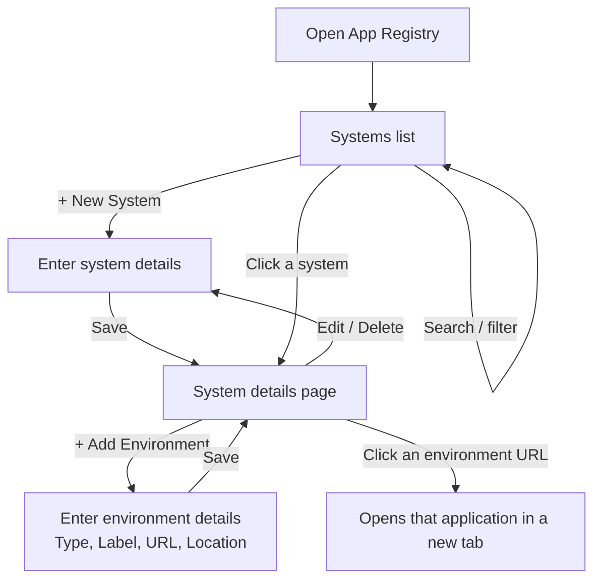
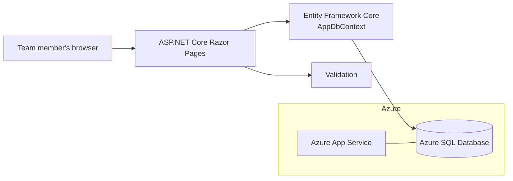
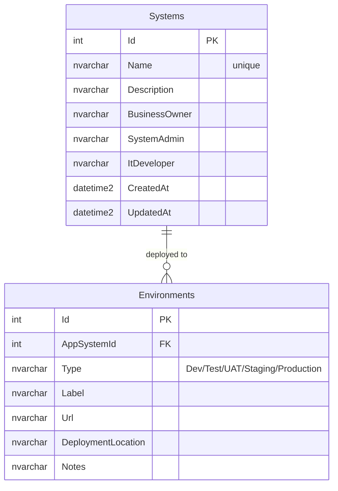
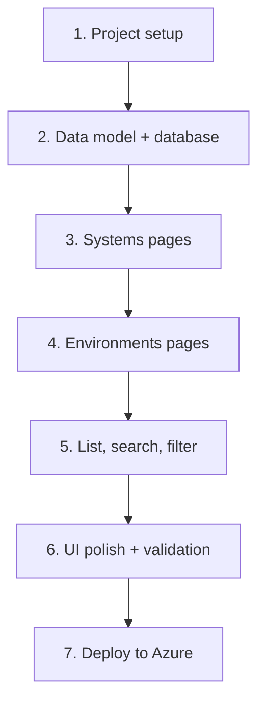

# App Registry

**One place to see every application our agency maintains: who owns it, who looks after it, and where each copy of it runs.**

App Registry is an internal web app. Team members open it in a browser, add the systems the agency supports, and record every environment those systems are deployed to (Dev, Test, UAT, Staging, Production), including the link users click and where it is actually hosted. Everything entered is saved to a central **Azure SQL** database, so the whole team works from the same up-to-date list.

It is built entirely on Microsoft technology: **ASP.NET Core**, **Entity Framework Core**, **Azure SQL Database**, and **Azure App Service**.

---

## Contents

- [What it tracks](#what-it-tracks)
- [How people use it](#how-people-use-it)
- [Technology stack](#technology-stack)
- [Architecture](#architecture)
- [Database](#database)
- [Data entry guidelines](#data-entry-guidelines-for-the-team)
- [Project structure](#project-structure)
- [Getting started (developers)](#getting-started-developers)
- [Deployment to Azure](#deployment-to-azure)
- [Build roadmap and instruction files](#build-roadmap-and-instruction-files)
- [Future ideas](#future-ideas)

---

## What it tracks

### Systems
Each application the agency maintains is a **system**.

| Field | Required | Meaning |
|---|---|---|
| **Name** | Yes | The system's name. Must be unique. |
| **Description** | No | What the system does and who uses it. |
| **Business Owner** | Yes | The product owner, the person who sets the requirements. |
| **System Admin** | No | The person who administers the system day to day. |
| **IT Developer** | No | The developer who maintains the system. |

### Environments
Each system can be deployed to one or more **environments**. A system can have **more than one environment of the same type** (for example, two Production instances in different regions).

| Field | Required | Meaning |
|---|---|---|
| **Type** | Yes | One of `Dev`, `Test`, `UAT`, `Staging`, `Production`. |
| **Label** | No | Tells same-type environments apart, e.g. "Prod – East", "UAT 2". |
| **URL** | Yes | The link users click to open the application. |
| **Deployment Location** | Yes | Where it actually runs: Azure region, resource group, server name, etc. |
| **Notes** | No | Anything else worth knowing. |

---

## How people use it

No login is required. Anyone on the team with the link can view and enter data.



**Typical tasks**

1. **Add a new system:** Systems → **New System** → fill in the name, description and the three people → **Save**.
2. **Record where it is deployed:** open the system → **Add Environment** → choose the type, paste the URL, enter the deployment location → **Save**. Repeat for each environment.
3. **Find an application:** search by system name or owner, or filter by environment type.
4. **Open an application:** click any environment URL on a system's page.

---

## Technology stack

| Layer | Microsoft technology |
|---|---|
| Language / runtime | **C#** on **.NET 10 (LTS)** |
| Web framework | **ASP.NET Core Razor Pages** |
| UI styling | Bootstrap (ships with the ASP.NET Core template) |
| Data access | **Entity Framework Core** (code-first, migrations) |
| Database | **Azure SQL Database** (SQL Server for local development) |
| Hosting | **Azure App Service** |
| Secrets / config | App Service configuration settings; .NET User Secrets locally |
| Source control & CI/CD | GitHub or **Azure DevOps**, with GitHub Actions or Azure Pipelines |

**Recommended tools**

- **Visual Studio 2022+** (Windows) or **Visual Studio Code** with the **C# Dev Kit** extension (Mac/Windows)
- **SQL Server Management Studio (SSMS)** or the **MSSQL extension for VS Code**, for viewing and querying the database
- **Azure Portal** and the **Azure CLI** (`az`), for creating and managing Azure resources
- **.NET CLI** (`dotnet`) and the **EF Core tools** (`dotnet ef`)

---

## Architecture



- **Razor Pages** serve the screens (list, create, edit, details, delete).
- **Validation** rules on the models stop bad data before it reaches the database (required fields, valid URLs, maximum lengths).
- **Entity Framework Core** maps C# classes to SQL tables and manages schema changes through **migrations**.
- **Azure SQL** is the single shared source of truth. Every entry from every coworker lands here.

---

## Database

Two tables with a one-to-many relationship: one system has many environments.



- Deleting a system **also deletes its environments** (cascade delete).
- The schema is owned by **EF Core migrations** in the code. Change it by adding a migration, not by editing tables by hand, so the code and database never drift apart.

---

## Data entry guidelines for the team

Several coworkers will be entering data into the same SQL database, so consistency matters.

- **Use the web app to enter and edit data.** It checks required fields and URL formats, and it keeps timestamps up to date. Direct SQL inserts skip those checks.
- **Check before you create.** Search for the system first so you don't create a duplicate. Names must be unique.
- **Use full names for people** (e.g. "Jane Smith", not "Jane" or "JS").
- **Paste the full URL**, including `https://`.
- **Be specific about location**, e.g. `Azure – East US 2 – rg-payroll-prod` or `On-prem – SRV-APP-04`.
- **Use Label** whenever a system has more than one environment of the same type.
- **Read-only SQL access is fine.** For reports, query the database with SSMS or VS Code (see example below). For bulk changes, talk to the app maintainer first.

```sql
-- Every production URL, by system
SELECT s.Name, s.BusinessOwner, e.Label, e.Url, e.DeploymentLocation
FROM Systems s
JOIN Environments e ON e.AppSystemId = s.Id
WHERE e.Type = 'Production'
ORDER BY s.Name;
```

---

## Project structure

```
app-registry/
├── README.md                     ← you are here
├── AppRegistry.sln
├── docs/                         ← step-by-step instruction file for each component
└── src/
    └── AppRegistry.Web/
        ├── Program.cs            ← app startup, database registration
        ├── appsettings.json
        ├── Models/
        │   ├── AppSystem.cs
        │   ├── AppEnvironment.cs
        │   └── EnvironmentType.cs
        ├── Data/
        │   └── AppDbContext.cs
        ├── Migrations/           ← generated by EF Core
        ├── Pages/
        │   ├── Systems/          ← Index, Create, Details, Edit, Delete
        │   └── Environments/     ← Create, Edit, Delete
        └── wwwroot/              ← CSS, JS, Bootstrap
```

---

## Getting started (developers)

### Prerequisites
- [.NET 10 SDK](https://dotnet.microsoft.com/download)
- EF Core tools: `dotnet tool install --global dotnet-ef`
- A SQL Server database: either a dev **Azure SQL** database, or **SQL Server running in Docker** for local work
- Visual Studio or VS Code with C# Dev Kit

### Run locally

```bash
# 1. Clone and enter the project
git clone <repo-url> app-registry
cd app-registry/src/AppRegistry.Web

# 2. Store the connection string securely (never commit it)
dotnet user-secrets set "ConnectionStrings:AppRegistry" "Server=...;Database=AppRegistry;User Id=...;Password=...;Encrypt=True;"

# 3. Create or update the database schema
dotnet ef database update

# 4. Run the app
dotnet run
```

Then open the URL shown in the terminal (e.g. `https://localhost:5001`).

### Changing the database schema

```bash
dotnet ef migrations add <DescriptiveName>
dotnet ef database update
```

Commit the generated files in `Migrations/`.

---

## Deployment to Azure

| Resource | Purpose |
|---|---|
| **Resource Group** | Holds everything for App Registry |
| **Azure SQL Server + Database** | Stores all systems and environments |
| **App Service Plan + Web App** | Hosts the ASP.NET Core application |

**Steps (summary).** The full walkthrough is in `docs/07-deploy-to-azure.md`.

1. Create the Azure SQL database and allow access from Azure services.
2. Create the App Service web app (.NET 10 runtime).
3. In the web app, go to **Settings → Environment variables → Connection strings** and add `AppRegistry` with the Azure SQL connection string.
4. Apply migrations to Azure SQL (`dotnet ef database update` against the Azure connection string, or a migration bundle in the pipeline).
5. Publish the app from Visual Studio (**Publish → Azure**), with `az webapp deploy`, or through a GitHub Actions / Azure Pipelines workflow.
6. Open the App Service URL and share it with the team.

---

## Build roadmap and instruction files

The app is built in parts, one at a time, and each part has its own instruction file in `docs/` explaining **what was built, the exact steps, how to verify it, and why it works that way**.



| # | Component | Instruction file | Status |
|---|---|---|---|
| 1 | Project setup | [`docs/01-project-setup.md`](docs/01-project-setup.md) | ✅ |
| 2 | Data model & database | [`docs/02-data-model-and-database.md`](docs/02-data-model-and-database.md) | ✅ |
| 3 | Systems pages | [`docs/03-systems-pages.md`](docs/03-systems-pages.md) | ✅ |
| 4 | Environments pages | [`docs/04-environments-pages.md`](docs/04-environments-pages.md) | ✅ |
| 5 | List, search & filter | [`docs/05-list-and-search.md`](docs/05-list-and-search.md) | ✅ |
| 6 | UI polish & validation | [`docs/06-ui-and-validation.md`](docs/06-ui-and-validation.md) | ☐ |
| 7 | Deploy to Azure | [`docs/07-deploy-to-azure.md`](docs/07-deploy-to-azure.md) | ☐ |

---

## Future ideas

- **Sign-in with Microsoft Entra ID** (work accounts) to record who changed what
- **People directory** so owners/admins/developers are picked from a list instead of typed
- **Change history / audit log** per system
- **Export to Excel** or a **Power BI** report on top of the Azure SQL database
- **Health checks** that ping each environment URL and show whether it's up
